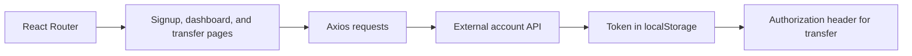

# Wallet Interface Prototype

**A React frontend for exploring account signup, user discovery, and transfer forms.**

This project demonstrates client-side routing, form state, API requests, and token handling in a small wallet-style interface. It is a frontend learning project; the account backend is external to this repository.

## Screens and behavior

| Route | Current implementation |
|---|---|
| `/signup` | Submits account details and stores the returned token |
| `/signin` | Renders a sign-in form; request handling is not wired up |
| `/dashboard` | Displays a fixed example balance and a searchable user list |
| `/send` | Reads recipient details from query parameters and submits a transfer request |

## Architecture



## Run locally

Download and extract the repository, then run:

```bash
npm install
npm run dev
```

Open the local URL printed by Vite and navigate to `/signup`. There is no home route at `/` in the current router.

## Backend connection

The source contains an inline hosted API base URL. Configure the requests in `Signup.jsx`, `SendMoney.jsx`, and `Users.jsx` for your own development backend before submitting data.

The expected operations are:

- `POST /api/v1/user/signup`
- `GET /api/v1/user/bulk?filter=...`
- `POST /api/v1/account/transfer`

The transfer request includes `to` and `amount`, plus a bearer token from local storage. No API URL environment variable is implemented in the current source.

## Example flow

With a compatible test backend, create a sample account, search for a test recipient on the dashboard, and open the transfer form. The form calls the backend when **Initiate Transfer** is pressed; it currently does not display completion or failure feedback.

## Repository guide

- `src/App.jsx`: route declarations.
- `src/pages/`: account, dashboard, and transfer screens.
- `src/components/`: reusable fields, buttons, balance, and user list.
- `src/index.css` and `tailwind.config.js`: styling setup.

`npm run build`, `npm run preview`, and `npm run lint` are declared in `package.json`.

## Scope and contributions

The displayed balance is a hard-coded example. Sign-in, protected routes, validation, missing-recipient handling, and transfer feedback need further implementation. Treat this as a demonstration with test accounts, not a real-money wallet.

Contributions should document the expected backend request/response contract and show the resulting UI state.
